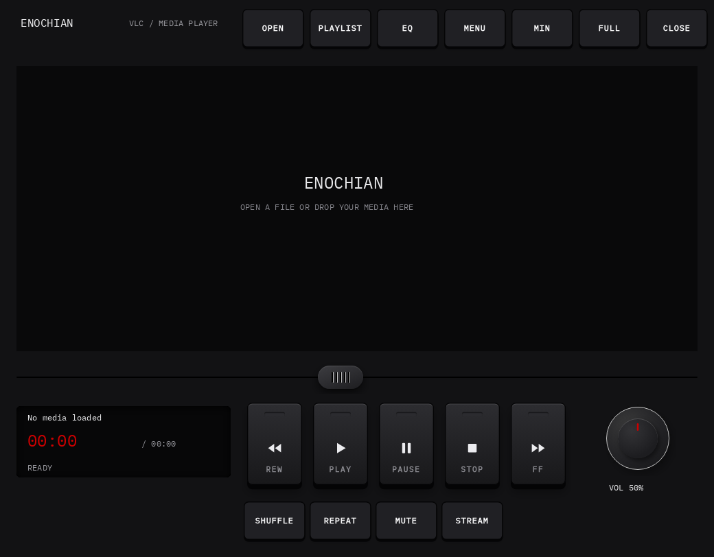
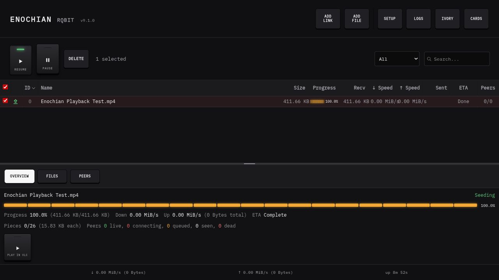

# Enochian Scryer Media Player

A matching media suite for Omarchy: **Enochian VLC** for playback and **Enochian Rqbit** for torrent transfers, connected by a **Play in VLC** key.

The suite reuses the original controls from [Enochian Elements](https://uiux-nonhumanintelligence.web.app/UIUX). Tape Deck transport keys, Drum Machine utility buttons, rotary volume and ribbed sliders retain their original artwork, materials and states. The two apps offer matching Obsidian and Ivory finishes.





[Ivory VLC preview](vlc/previews/ivory.png) · [Ivory rqbit preview](previews/rqbit-ivory.png)

## Install on Omarchy

Install the system playback components with:

```sh
omarchy pkg add vlc vlc-gui-skins2 vlc-plugin-ffmpeg xorg-xwayland
```

Python 3 and Chromium are also needed for the transfer companion. For a checkout from GitHub, build its interface and fetch the verified engine first:

```sh
cd rqbit
enochian/build.sh
cd ..
```

The [ready-to-install Linux bundle](https://github.com/alanism/enochian-scryer-media-player/releases/latest) already contains that engine and interface. Download and extract it before running the installer. Install both apps, with the player as the MP4 default:

```sh
./install.sh --make-default
```

Open **Enochian VLC** or **Enochian Rqbit** from the Omarchy launcher. The companion sends torrent media directly to VLC; the torrent engine continues running when the player closes. See [companion controls and background-service behavior](rqbit/enochian/README.md) and [VLC controls](vlc/README.txt).

In the companion's **Cards** view, double-click a completed torrent to play its downloaded media in Enochian VLC. Right-click a card and choose **Show file** to reveal the download in your file manager. Incomplete cards wait for completion; the explicit **Play in VLC** key still supports streaming while a download is in progress.

Cards now show the original Tape Deck **Play in VLC** key directly. Separate, labeled Drum Machine utility keys control transfers and files. Both finish and view choices stay visible; the chosen view is remembered. See the [Enochian control/function map](docs/ENOCHIAN_CONTROL_MAP.md) and [engineering/design council review](docs/COUNCIL_REVIEW.md) for decisions, fixes and verification.

When updating an already running companion, use its **Stop transfers and service** launcher action before installing, then reopen the app. Transfer records persist across the restart.

## Build plan and design evaluation

Open [the HTML Kanban board](docs/build-board.html) locally to follow the work. It has expandable task cards, individual progress bars, an overall checklist percentage, and separate design scores. Serve `docs/` with `python3 -m http.server 19400 --bind 127.0.0.1 --directory docs` for live updates; opening the HTML directly shows its embedded snapshot. Task updates are made with `python3 tools/evaluation/plan.py TASK_ID --status working --completed N --note "Evidence or remaining work"`.

[Iteration 1 evaluation and evidence](docs/evaluation/index.html) applies four frozen, 20-criterion, five-level rubrics. Current self-evaluations are Ryo Lu **77**, GMUNK **84**, Jayse Hansen **84**, and Satori **82** out of 100. The independent 95+ gates remain unmet: native VLC picker, playlist Save/export and control gestures still need direct desktop validation. No designer endorsement or independent expert review is claimed.

This iteration enlarges the original player keys and labels, adds explicit Playlist/Sort/Manage routes, reviews each torrent in a multiple-file import, resets destructive choices on dismissal, uses MB/s limits, and preserves keyboard focus through dialogs and transfer controls. Standard player size is now 1040×812; compact is 832×650. Advanced native VLC dialogs remain Qt dialogs.

## Why two apps

rqbit already streams files through range-enabled HTTP and prioritizes pieces requested by a player. Keeping transfers in a companion avoids tying download lifetime to a VLC window. The local bridge accepts a torrent/file choice and launches the installed Enochian VLC with the stream URL and matching finish. No public server or browser extension is needed.

## Implementation

- `vlc/`: four VLC 3 Skins2 packages (Obsidian/Ivory, standard/compact), launcher, user installer and original component snapshots/build sources. VLC itself comes from the system packages; this is a skin integration, not a VLC engine fork.
- `rqbit/`: the upstream rqbit source at `f23bacdddcc5318caa813418b8eb1b1d7307faaa`, with the shared React interface reskinned and a Linux companion in `rqbit/enochian/`.
- `rqbit/enochian/provenance.json`: official rqbit 9.1.0 release URL and verified SHA-256. The standard Linux bundle uses this release engine; Rust compilation is optional.

The VLC interface uses XWayland on Omarchy. Its main player, playlist and equalizer are skinned. File pickers and advanced VLC dialogs remain system/Qt dialogs. The transfer companion uses a Chromium app window, rqbit's existing data views, and the original Enochian controls; its native file picker remains a system dialog.

## Checked on this machine

The MP4 desktop association opened the installed Obsidian VLC skin and reported Playing. rqbit's production frontend build passed. A private local MP4 torrent verified byte-for-byte HTTP 206 ranges, pause/resume, opening the installed VLC, Playing status and a five-second seek. Browser checks covered transfer selection, Overview/Files, the VLC action and both finishes without app console errors. Final checks also verified the amber Pause lamp, green Resume lamp, and compact progress-meter fit. See the component READMEs for the tested scope and remaining limits. No remote public torrent swarm or audible playback was tested.

## Sources and notices

[VLC](https://github.com/videolan/vlc), [rqbit](https://github.com/ikatson/rqbit), and [Enochian Elements](https://uiux-nonhumanintelligence.web.app/UIUX). Upstream code and bundled fonts retain their included licenses and notices. The Enochian artwork is not relicensed by rqbit's upstream license.
